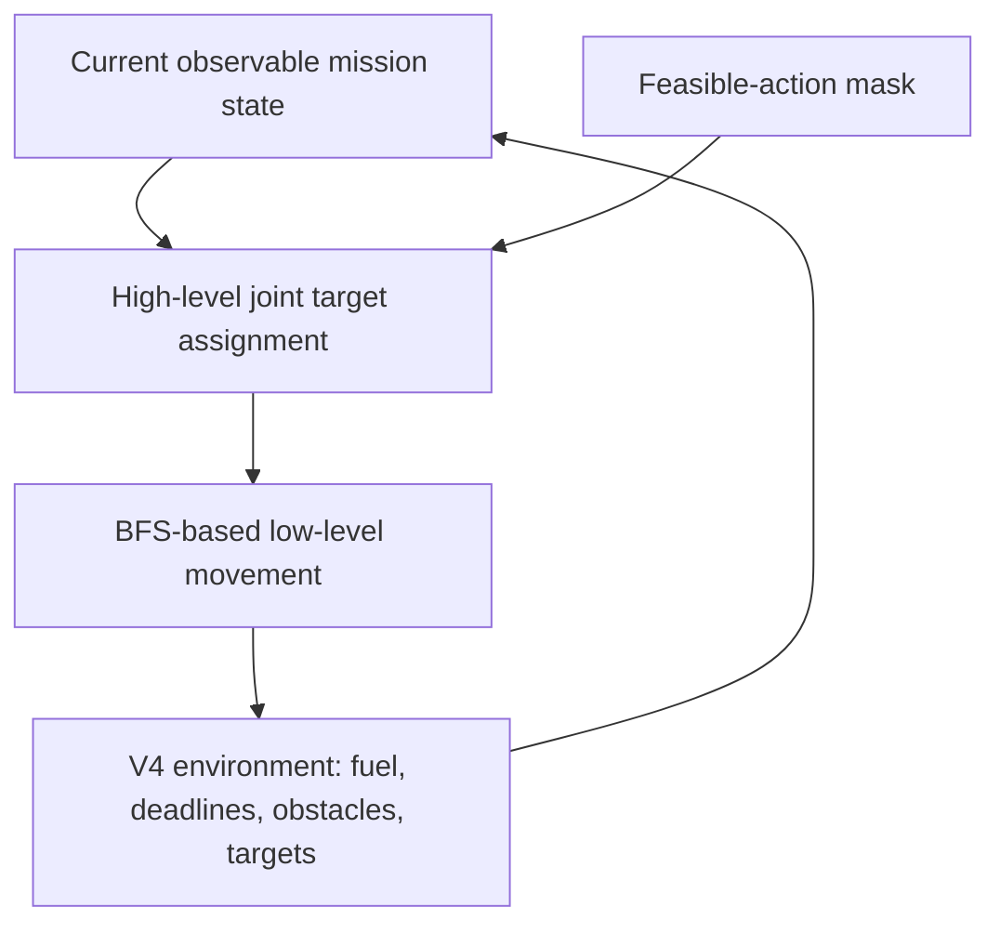

# MAMC-RL Multi-Agent Mission Control with Reinforcement Learning

**Hierarchical reinforcement learning vs. classical planning for time-critical, resource-constrained multi-agent missions.**

MAMC-RL is an independent research prototype investigating how two cooperative agents should allocate themselves to competing objectives when deadlines, limited fuel, agent-specific capabilities, and changing mission conditions interact. It combines custom [Gymnasium](https://gymnasium.farama.org/) environments, [MaskablePPO](https://sb3-contrib.readthedocs.io/), deterministic navigation, and resource-aware search baselines.

**Scope:** a synthetic 10×10 grid world, not  deployment-ready mission planner.

> **Main finding.** On a frozen set of **400 previously unused V4 missions**, depth-4 lookahead raised full-mission success from **44.0%** (resource-aware heuristic) to **51.0%**: a **+7.0 percentage-point paired improvement** (95% bootstrap CI **+3.0 to +11.0**). Its priority-weighted completion advantage was small and uncertain (**+0.58 points**, 95% CI **−0.61 to +1.81**), while its decision computation was approximately **87×** higher. Hierarchical masked PPO achieved **85.1%** weighted completion at heuristic-like decision latency, but only **33.0%** full-mission success.

## Research question

**How do hierarchical masked RL and bounded classical planning trade mission success, priority-weighted completion, and decision-time computation in dynamic multi-agent assignment?**

The work tests three related ideas:

1. Whether learning high-level assignments can compete with resource-aware scheduling heuristics.
2. Whether deeper lookahead improves deadline-constrained mission completion enough to justify its computational cost.
3. Whether imitation learning can transfer a slower planner's decisions into a fast neural policy.

## Environment and control architecture

V4 contains **two agents**, **four priority-weighted objectives**, and a shared discrete movement simulator. The urgent fourth objective appears during execution. Objectives can expire; obstacles may change; agents have finite fuel and different target capabilities.

| Objective | Eligible agents | Deadline (primitive steps) |
|---|---|---:|
| A | Agent 0 only | 12 |
| B | Agent 1 only | 18 |
| C | Either agent | 24 |
| D (urgent, appears later) | Agent 1 only | 23 |

Fuel budgets are **16** and **18** movement units. The target priorities sum to **9**. A mission succeeds only when **all four objectives** are completed; *weighted completion* measures the acquired priority divided by 9.

The controller operates at two levels:



At the high level, each agent may idle or choose one of four objectives, yielding **25 nominal joint assignments**. Feasibility masks rule out assignments to unavailable, completed, expired, or capability-incompatible targets and agents with no usable fuel. The shared BFS-based low-level controller executes movement for up to **three primitive steps per assignment** by default, with environment-dependent interruptions. Mask legality is **not** a guarantee that the entire mission is achievable.

The progressive benchmarks isolate different difficulties:

| Version | Added challenge | Key lesson |
|---|---|---|
| **V1** | Cooperative target collection | Establishes a minimal joint-action RL environment |
| **V2** | Dynamic objectives and changing obstacles | Masked hierarchical PPO solved all 500 held-out missions in each of three training runs, making V2 useful for validating the architecture but insufficient as a hard final benchmark |
| **V3** | Priority-weighted deadlines | PPO achieved ~95.4% weighted completion but ~70.2% full success across three training seeds; the deadline-aware heuristic remained stronger |
| **V4** | Heterogeneous capabilities and finite fuel | Reveals a more consequential gap between high priority acquisition and completing *every* objective |

## Methods

All four primary controllers share the same V4 environment and low-level movement mechanism:

- **Masked random:** samples a legal joint assignment as a reference baseline.
- **Resource-aware heuristic:** greedy assignment using capability, distance, deadline, and fuel information.
- **Hierarchical MaskablePPO:** `[128, 128]` MLP choosing masked high-level assignments; the frozen comparison uses the **seed-42, option-horizon-3** checkpoint.
- **Depth-4 lookahead:** beam search (width **4**) over copied simulator states, scoring completed/expired priorities, remaining reachable work, fuel use, and elapsed time. Forecasts suppress unknown future obstacle changes and future urgent-target spawning; they are **approximate**, not clairvoyant or optimal.

## Primary results — frozen V4 evaluation

**Protocol:** 400 initial mission seeds, **30000–30399**, held out from development. The four policies and PPO checkpoint were fixed before this evaluation. Intervals are **95% percentile bootstrap CIs** across mission seeds using 10,000 resamples. Controller times exclude simulator execution and were measured on the same machine; they are not hardware-independent latency guarantees.

| Controller | Full success (95% CI) | Weighted completion (95% CI) | Mean expired objectives | Mean computation / decision |
|---|---:|---:|---:|---:|
| Masked random | 6.8% [4.5, 9.2] | 55.4% [53.0, 57.7] | 1.92 | 0.018 ms |
| Resource heuristic | 44.0% [39.2, 48.8] | 86.1% [84.6, 87.6] | 0.64 | 0.413 ms |
| Hierarchical masked PPO | 33.0% [28.2, 37.5] | 85.1% [83.4, 86.8] | 0.85 | 0.450 ms |
| **Depth-4 lookahead** | **51.0% [46.2, 56.0]** | **86.7% [85.1, 88.2]** | **0.56** | **35.968 ms** |

**Paired differences versus the resource heuristic** (percentage points, resampling the same *initial mission seeds* together):

| Comparison | Full-success difference (95% CI) | Weighted-completion difference (95% CI) |
|---|---:|---:|
| PPO − heuristic | **−11.00 [−14.75, −7.25]** | −0.94 [−2.11, +0.19] |
| Lookahead − heuristic | **+7.00 [+3.00, +11.00]** | +0.58 [−0.61, +1.81] |

**Interpretation.** Lookahead's advantage in *all-objective success* is supported by the paired interval on this benchmark. The evidence does **not** establish that it improves *weighted completion* over the heuristic. PPO acquires much of the available priority at low computational cost but is less reliable at finishing every objective. Different actions can cause different subsequent obstacle realizations: the evaluations are paired by **initial seed**, not by identical full future trajectories.

### Development experiments and negative results

These are **exploratory/development** findings, primarily from seeds **2000–2199**; they are not additional untouched final-test results.

| Experiment | Finding |
|---|---|
| Lookahead depth (beam width 4) | Depths **2 / 4 / 6** achieved **50.0% / 57.5% / 56.5%** full success on 200 development missions; deeper search was not monotonically better |
| Option-horizon ablation | Horizons **1 / 3 / 5** all achieved **39.5%** full success for the tested seed-42 PPO variants; planning frequency alone did not improve this result |
| Behavioral cloning (BC) | **51.2%** agreement on 926 expert validation decisions; **67.6%** weighted completion and **29.0%** full success in closed-loop development evaluation |
| DAgger | Adding **2,935** expert labels across three rounds did not improve reliably; round 3 fell to **60.8%** weighted completion and **19.0%** full success |
| Root-preserving lookahead | On 30 development missions, a much slower independent-per-root search did not outperform the original global-beam planner |

These failures matter: **more expert labels, more search, or more frequent replanning did not automatically create a better controller.** Their causes are not conclusively isolated. Exact expert-action agreement can be limited by ambiguous assignments, observation/representation differences, and distribution shift.

## Reproducibility

**Code:** Python 3.11 recommended. Main dependencies include NumPy, Gymnasium, PyTorch, Stable-Baselines3, sb3-contrib, and pytest. Use a virtual environment; a fully pinned dependency lockfile is not currently included in this repository snapshot.

```powershell
python -m venv .venv
.\.venv\Scripts\Activate.ps1
python -m pip install numpy gymnasium torch stable-baselines3 sb3-contrib pytest
python -m pytest -q
```

The **frozen evaluation** uses a locally saved PPO checkpoint, which is **not included by default**. To inspect the original primary results, preserve and consult the output files from that run:

```text
results/final_v4/
  episodes.csv     # per-mission observations and outcomes
  summary.json     # controller metrics and bootstrap intervals
  summary.md       # human-readable tables
  protocol.json    # seeds, configuration, checkpoint/code SHA-256 hashes
models/v4_horizon3_matched_seed42.zip  # frozen PPO checkpoint (local artifact)
```

To reproduce the protocol **only with the exact archived checkpoint and code revision**, the command was:

```powershell
python final_evaluation_v4.py --ppo-model models/v4_horizon3_matched_seed42.zip --episodes 400 --seed-start 30000 --out-dir results/final_v4
```

The final seeds have **already been used for final reporting**: do not use them to select new models or tune hyperparameters. The script refuses to overwrite existing outputs unless explicitly instructed. For a fresh experiment, choose a new seed range and output directory. The [V4 training script](train_masked_v4.py), [evaluation script](final_evaluation_v4.py), [planner](mamc_rl/lookahead_v4.py), and [tests](tests/) contain the implementation details. **The reported confidence intervals and checkpoint identity can be independently verified only when the corresponding archived results and checkpoint are supplied.**

## Limitations and takeaway

This is a **small, deliberately abstract simulator** with two agents, four objectives, fixed capability and fuel configurations, and a shared hand-designed low-level controller. One preselected PPO checkpoint was used in the final four-controller comparison; earlier PPO multi-seed results provide context but do not replace this test. Planning uses a surrogate scoring function and imperfect future forecasts, not optimal search. Neither benchmark scores nor measured latency establish flight-system robustness, safety, or real-time deployment suitability.

**Takeaway:** In this V4 benchmark, bounded lookahead buys a measurable increase in complete-mission success at a steep computational cost. Hierarchical masked PPO produces strong priority-weighted allocation with low decision latency, but does not close the full-success gap. Distilling the planner into a fast policy remains an open question rather than a demonstrated success.

---

*Independent research project · [Source code](https://github.com/eciile/multi-agent-mission-control-RL)*
